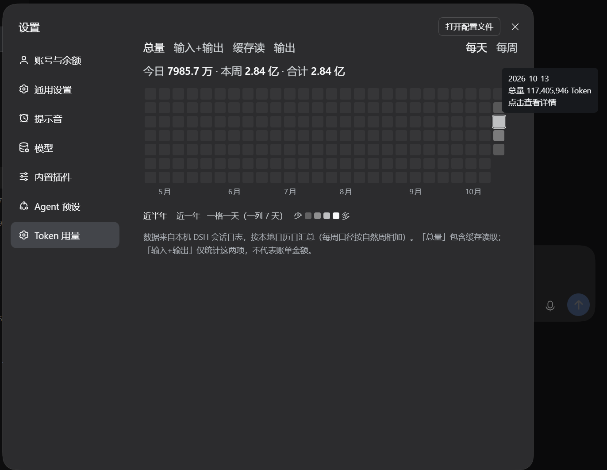
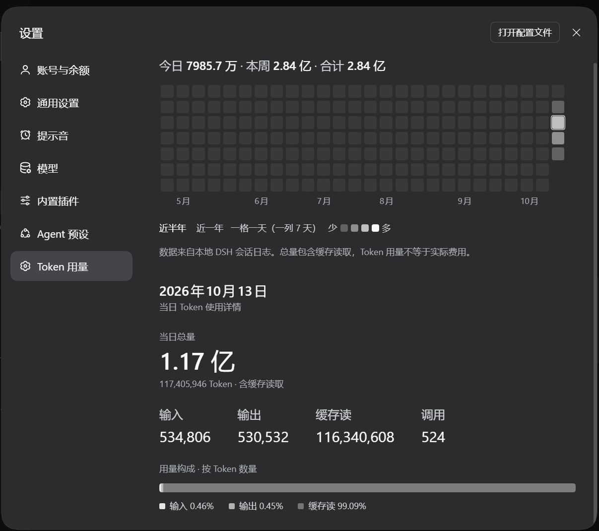
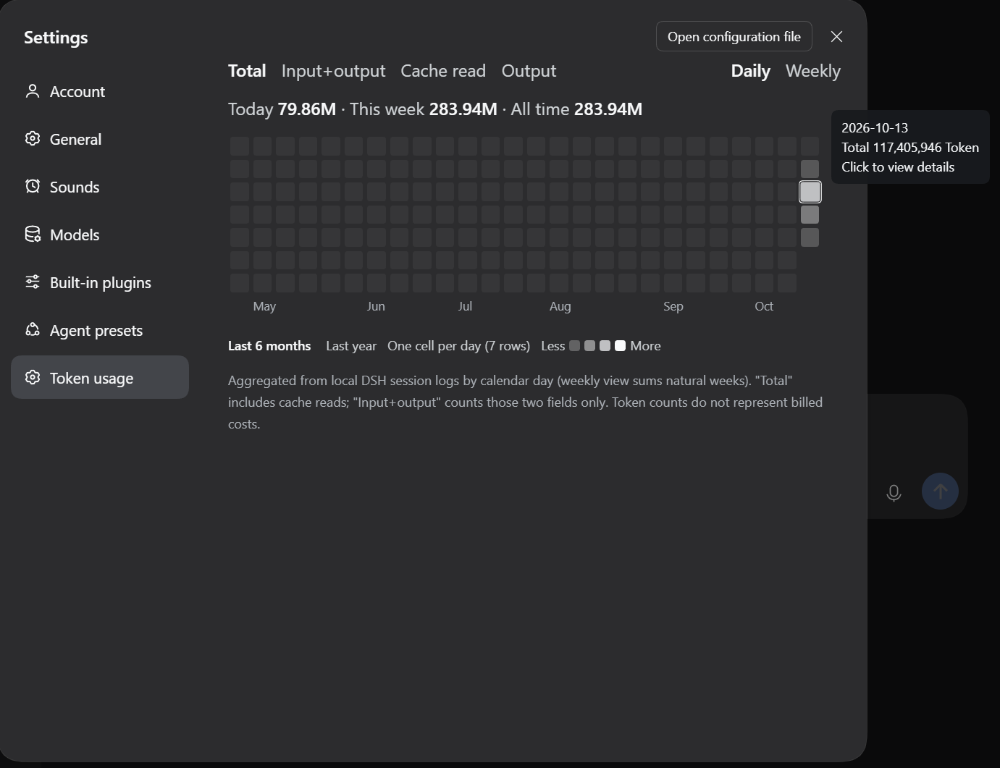
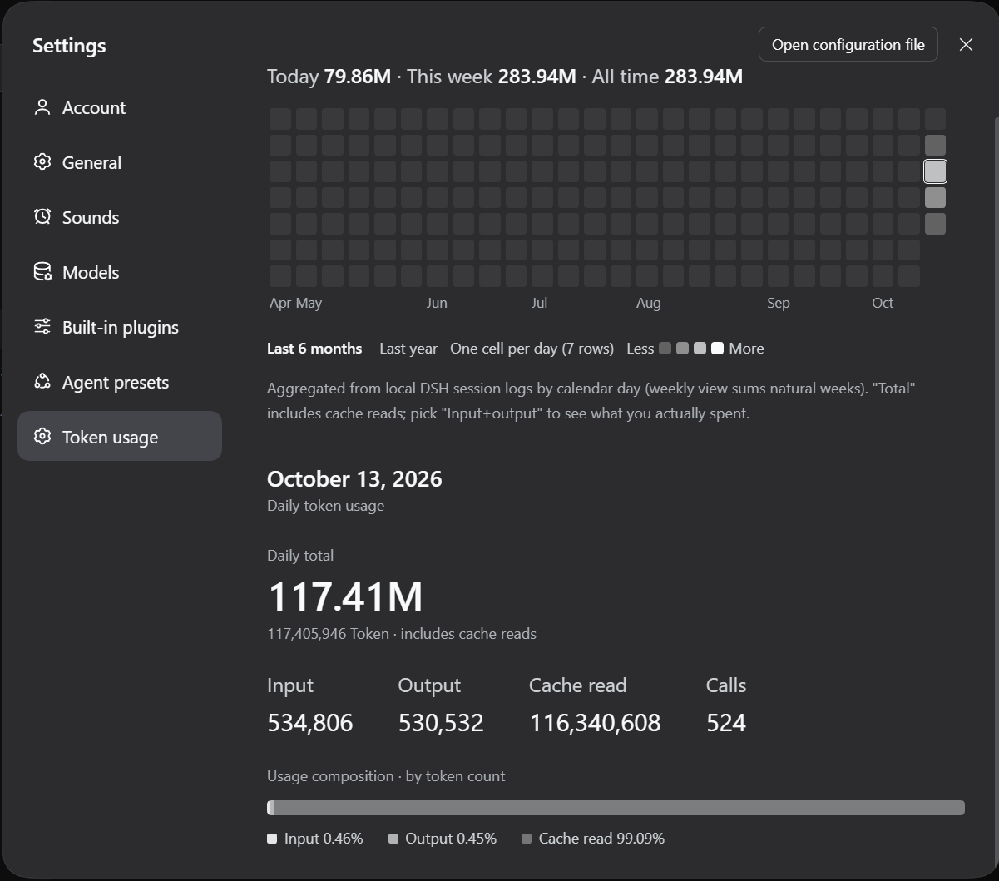

# dsh-token-heatmap

中文 | [English](README.md)

在 DSH **设置**里增加一节「Token 用量」：每日 token 消耗热力图，一格一天，以主题灰阶表示每日相对用量。

数据来源为本机 DSH 会话日志，**不向外部服务发送请求，无需单独记录用量**。

> **隐私**：本插件不发起任何外部请求。会话日志只在本机读取，聚合结果只交给本机的 DSH 页面。
> 仓库里没有任何个人数据或密钥。

## 界面示例

### 半年热力图与悬浮提示

设置 → **Token 用量**，默认展示近半年。上方可切换总量、输入+输出、缓存读和输出，以及每天 / 每周口径；下方可切换近半年 / 近一年。全年分为上下两排展示。

悬停日期格子时，提示框依次显示日期（YYYY-MM-DD）、当前统计口径的 Token 数量，以及「点击查看详情」。下图以 2026-10-13 为例，显示总量 117,405,946 Token；点击该格子后，可在页面下方查看当日明细。格子外圈表示悬停或选中状态，今天的格子不会默认高亮。



### 当天详情与 Token 构成

点击日期，在热力图下方直接显示当天详情，无需切换页面；再次点击同一日期可收起详情；点击其他日期则切换当天详情，筛选保持可用。

详情展示总量、输入、输出、缓存读取及调用次数；存在缓存写入时一并显示。底部灰阶构成条按实际 Token 数量分段，附各项占比。图中 2026 年 10 月 13 日总量为 117,405,946 Token，缓存读取占 99.09%。这些数字仅为截图示例，实际用量来自你的本机日志。



### 英文界面

标签、月份、日期和数字单位跟随宿主语言；同一天的总量在中文显示为「1.17 亿」，英文显示为「117.41M」。





## 功能

- 默认近半年（26 周）；可切换近一年，全年分为上下两排（27 + 26 周），各排带月份刻度
- 格子上限 20px、间距 4px，按容器宽度适配，避免横向滚动条
- **每天 / 每周**：每日独立色阶，或同一自然周整列同色；周日到周六排列，未来日期留空
- **四种口径**：总量 / 输入+输出 / 缓存读 / 输出；使用主题灰阶表示相对高低
- 悬浮或聚焦显示对应日期、当前口径的 Token 数量和「点击查看详情」；周视图标注本周数量
- 点击日期，在下方原位显示当天总量、输入、输出、缓存读取、调用次数，以及非零缓存写入；周视图点击仍查看所点日期
- Token 构成条按实际数量展示各分项及比例；没有用量时显示空状态
- 首次加载斜向铺开约 600ms，顶部统计不等待动画；切换口径、范围或选择日期不重播
- 原生按钮支持 Enter/Space，保留焦点反馈；尊重系统减少动态效果设置
- 摘要显示今日 / 本周 / 全部历史合计；每分钟刷新，窗口重新可见或聚焦时重新请求
- 中英文文案、月份、数字单位跟随宿主语言，深浅主题跟随宿主

## 数据来源

`<DSH_HOME>/sessions/<项目>/<会话>/session.v*.jsonl.zstd`

插件读取包含有效时间戳和 `data.usage` 的日志记录：

```
inputTokens / outputTokens / cacheReadTokens / cacheWriteTokens / totalTokens
```

外加 `time`（epoch 毫秒）与 `data.message.source.model`，按本地日历日聚合即得每日用量。

三个必须处理好的细节：

1. **日志包含多个 zstd 帧** —— 当前解析器依据帧魔数划分并分别解压，以保留可读取的帧。
2. **同一 `seq` 可能重复出现**（回放）—— 按 seq 去重，避免重复计数。
3. **会话写入中尾部可能出现截断帧** —— 只跳过那一帧，不要丢掉整个文件。

宿主侧按文件大小、修改时间和统计时区缓存解析结果，仅重新解析新增、修改或统计时区发生变化的文件。

### 关于口径

「总量」包含日志报告的缓存读取，缓存占比随使用情况变化。「输入+输出」仅统计这两项，不等于账单金额；插件不进行费用换算。

颜色分级用**分位数**（非零用量的 25/50/75 分位），不是绝对阈值，所以切换口径时量级差几十倍，热力图依然有可读的层次。

## 安装

桌面应用的 profile 由应用独占管理，`dsh plugin` 命令会拒绝改它，所以要在应用里装：

1. 打开 DSH → 侧栏 **插件** → **添加插件**
2. 填入本目录的绝对路径（命令行形式是 `dsh plugin add "link:<路径>"`）
3. 安装后重启应用
4. 进 **设置**，导航里会多出「Token 用量」

卸载：同一页面的组合包卡片 → 卸载。

## 配置

可选，写在 bundle 行的 `config` 里，不填就用默认值。

| 键             | 默认                  | 说明                            |
| -------------- | --------------------- | ------------------------------- |
| `timeZone`     | `Asia/Shanghai`       | 按哪个时区切"一天"              |
| `sessionsRoot` | `<DSH_HOME>/sessions` | 会话日志根目录                  |
| `maxDepth`     | `2`                   | 目录遍历深度（项目 / 会话两层） |

## 结构

| 路径                    | 说明                                                               |
| ----------------------- | ------------------------------------------------------------------ |
| `lib/index.js`          | 宿主侧：逐帧解压会话日志、按天聚合、注册 `/dsh-token-heatmap/data` |
| `client.js`             | 浏览器侧：注册进 `settings.section` 的 React 组件（热力图与切换）  |
| `package.json`          | 清单：`dsh.bundle.patch` 声明挂载，`dsh.client` 声明客户端模块     |
| `cordis.patch.yml`      | 挂载声明；`insert` 的 `name` 必须与包名完全一致                    |
| `tools/test-plugin.mjs` | 拿真实会话日志跑宿主侧聚合                                         |
| `tools/test-apply.mjs`  | 用桩 Cordis 上下文跑 `apply()`，验证路由注册                       |
| `tools/test-client.mjs` | 用 React 钩子桩验证客户端渲染与交互                                |
| `tools/test-host.mjs`   | 使用临时合成日志验证多帧、去重、缓存和时区切换                     |
| `tools/test-weekly.mjs` | 验算每周聚合：周边界、跨月刻度、不重复计数                         |

需要支持 `node:zlib` 的 `zstdDecompressSync` 的 Node.js（建议 Node.js 24）。客户端逻辑与周聚合测试不需要真实日志；`npm test` 使用确定性样例和宿主桩；`npm run test:logs` 读取本机日志，可通过 `DSH_SESSIONS_ROOT` 指定路径。

自测：

```bash
npm ci
npm run check
npm test
npm run test:logs
```

格式规范由 `.editorconfig` 和 Prettier 配置定义；执行 `npm run format` 统一格式，执行 `npm run check` 检查格式与入口语法。Prettier 仅用于开发，不参与插件运行。

## 实现要点

**通过宿主扩展槽注册界面。** 组件注册进 `settings.section`，只渲染 React 元素；
不直接导入 Harness Client 包，样式优先使用宿主主题变量。
（DSH 插件规范明确禁止往 `document.body` 追加元素或替换应用根节点。）

**自适应尺寸。** `ResizeObserver` 量容器宽度，算出每格边长写进 CSS 变量 `--dth-cell`：
半年按 26 列适配，全年按每排最多 27 列适配；格子上限 20px，计算时扣除间距和内边距。

**周对齐。** 从当前周的周日向前倒推 25 周或 52 周，因此每列都是完整自然周；今天之后的格子留空。
月份刻度贴在"包含该月 1 号"的那一列，并为每排起始列补充月份标签。

**本地化。** 界面文案通过翻译字典管理：插件用 `ctx.locale.register(ns, { zh, en })` 注册自己的命名空间字典，
再通过框架提供的翻译函数读取，所以切语言时这一节会重渲染。数字单位也跟着走（中文 `万/亿`，英文 `K/M/B`）。

客户端测试直接执行 `client.js`，使用 React 钩子桩覆盖首次可见帧、精简 Tooltip、页内详情、范围切换和构成条；不替代真实 DSH 中的布局、动画、焦点与主题验收。

更新内容见 [CHANGELOG.md](CHANGELOG.md)。

## License

MIT
